# FrontendSession : guide d'utilisation

FrontendSession permet à vos visiteurs de s'inscrire, de se connecter et de gérer leur compte directement sur le blog, sans passer par l'administration.

## Table des matières

1. [Réglages du blog](#réglages-du-blog)
2. [La page « Mon compte »](#la-page--mon-compte-)
3. [Inscription d'un visiteur](#inscription-dun-visiteur)
4. [Valider les inscriptions](#valider-les-inscriptions)
5. [Connexion et changement de mot de passe](#connexion-et-changement-de-mot-de-passe)
6. [Mot de passe oublié](#mot-de-passe-oublié)
7. [Le widget](#le-widget)
8. [Limiter les commentaires](#limiter-les-commentaires)
9. [Bon à savoir](#bon-à-savoir)

## Réglages du blog

Allez dans **Paramètres du blog**, puis ouvrez « Paramètres des plugins pour ce blog ». Le bloc « Frontend sessions » est vide au départ.

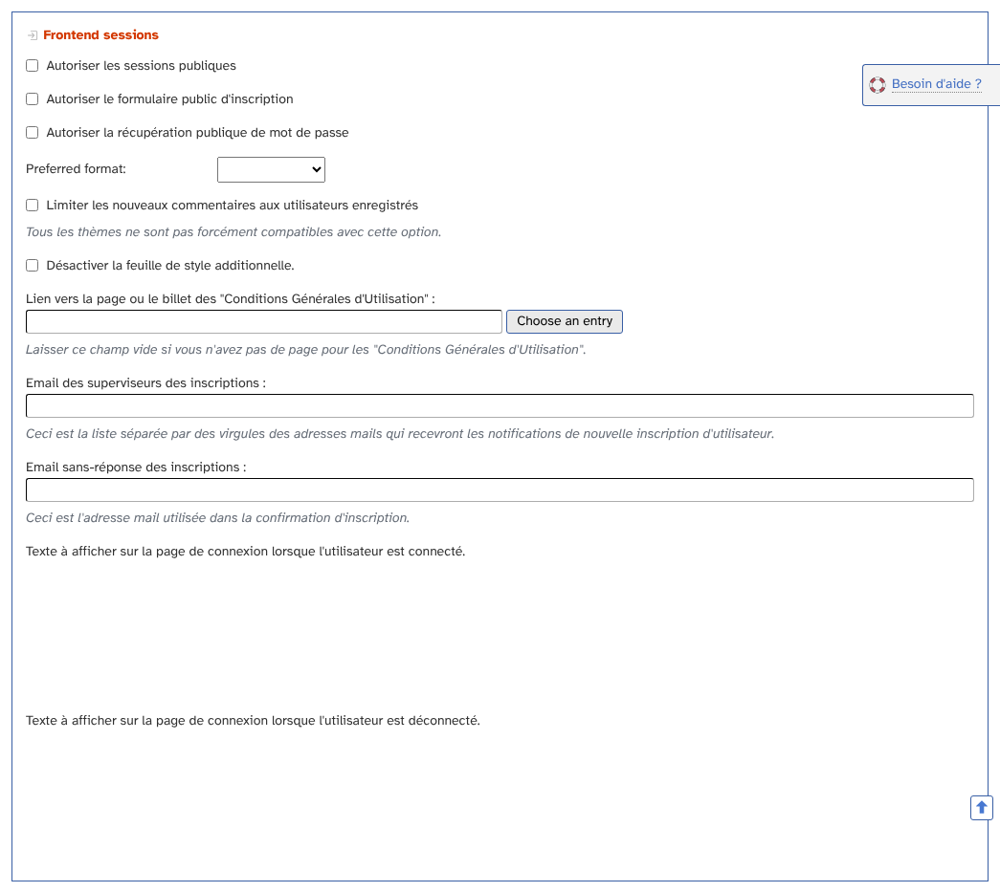

Cochez ce dont vous avez besoin :

* **Autoriser les sessions publiques** : active la page de connexion.
* **Autoriser le formulaire public d'inscription** : les visiteurs peuvent créer un compte.
* **Autoriser la récupération publique de mot de passe** : les visiteurs peuvent demander un nouveau mot de passe.

Renseignez ensuite les adresses mail :

* **Email des superviseurs des inscriptions** : les adresses (séparées par des virgules) qui reçoivent un mail à chaque nouvelle inscription.
* **Email sans-réponse des inscriptions** : l'expéditeur des mails envoyés aux visiteurs.

Vous pouvez aussi indiquer le lien de la page « Conditions Générales d'Utilisation ». Si vous le remplissez, les visiteurs doivent cocher une case pour s'inscrire. Laissez vide sinon.

Les deux zones de texte permettent de personnaliser le message affiché sur la page quand le visiteur est connecté ou déconnecté. La case « Désactiver la feuille de style additionnelle » retire le style fourni par le plugin.

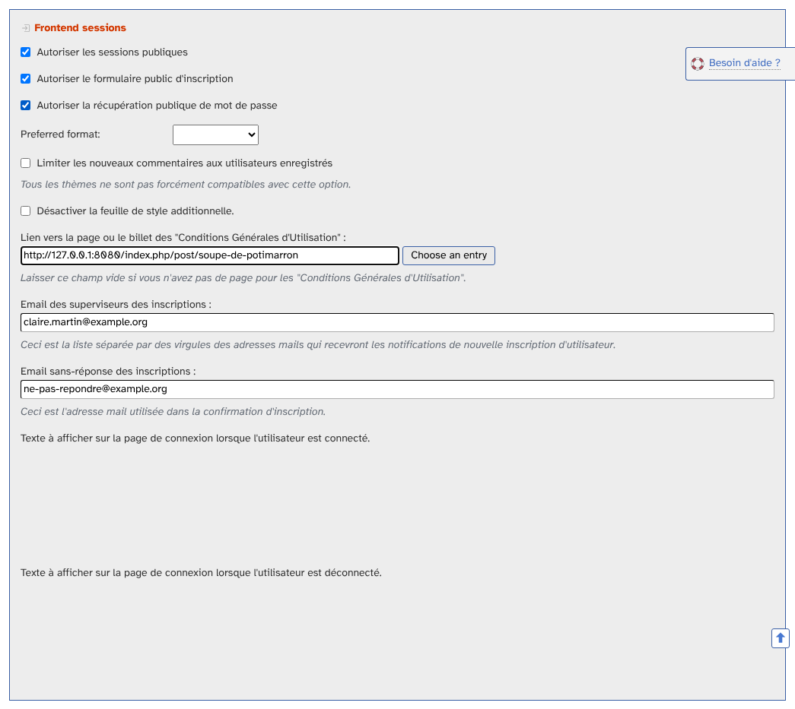

## La page « Mon compte »

Elle se trouve à l'adresse `/session` de votre blog. Pour un visiteur déconnecté, elle propose trois formulaires : se connecter, s'inscrire et récupérer son mot de passe. Seuls les formulaires autorisés dans les réglages sont affichés.

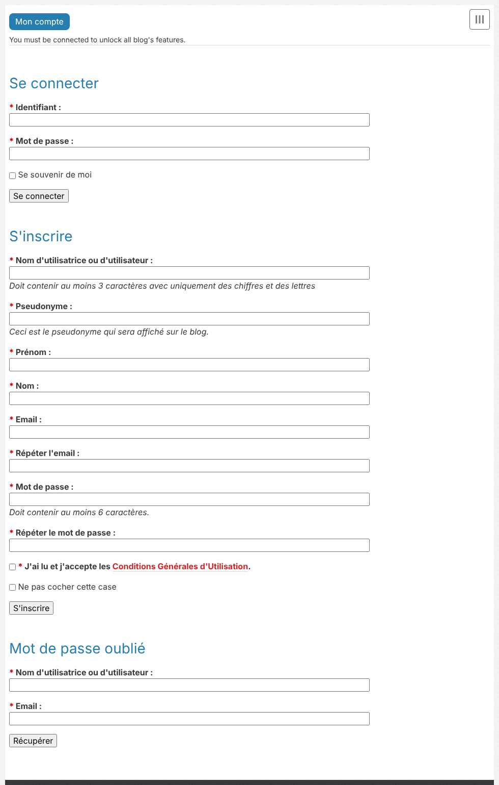

Vous pouvez ajouter un lien vers cette page dans le menu du blog avec le plugin « Menu simple » : choisissez le type « Page de connexion publique ».

## Inscription d'un visiteur

Le visiteur remplit le formulaire : identifiant (3 caractères minimum, lettres et chiffres), pseudonyme, prénom, nom, email (deux fois) et mot de passe (6 caractères minimum, deux fois). Il doit cocher les conditions d'utilisation si vous en avez indiqué.

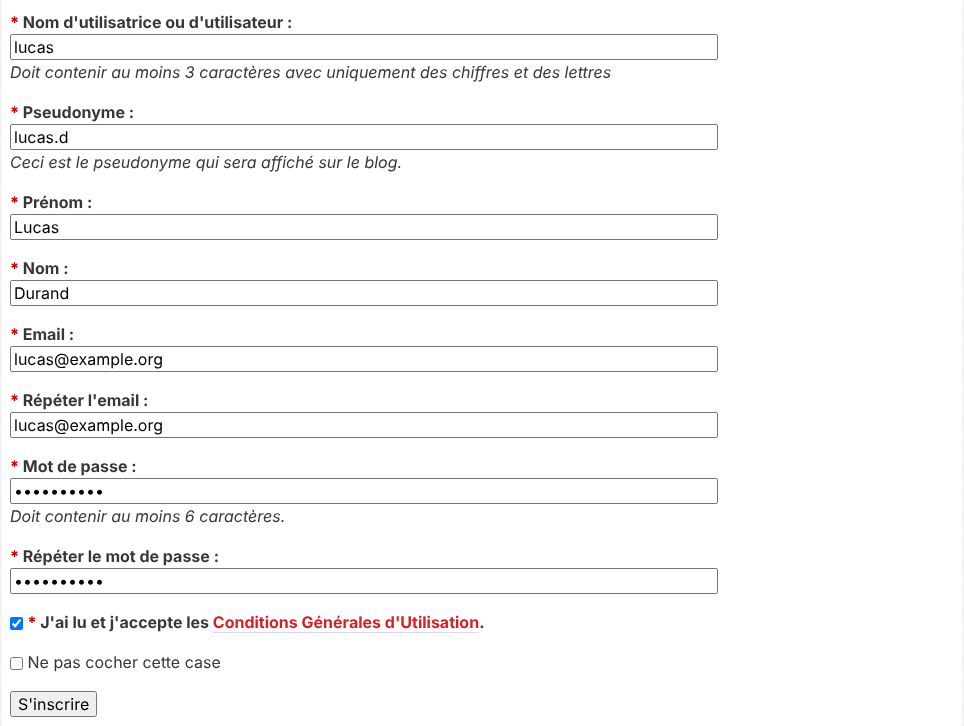

Après l'envoi, un message le prévient qu'un administrateur validera sa demande.

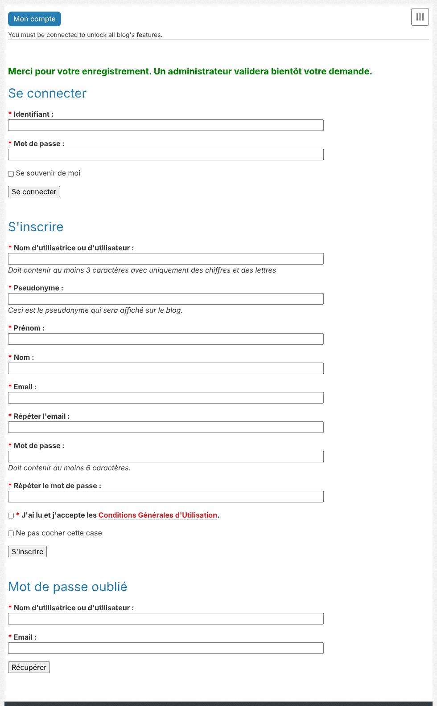

Le visiteur reçoit un mail de confirmation et les superviseurs reçoivent un mail avec un lien vers la liste des inscriptions en attente. Tant que le compte n'est pas validé, la connexion est refusée.

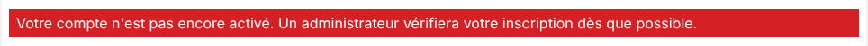

## Valider les inscriptions

Dans l'administration, ouvrez **Système → Utilisateurs** et filtrez sur l'état « Inscription en attente ». Un compteur d'inscriptions en attente est aussi affiché sur le tableau de bord.

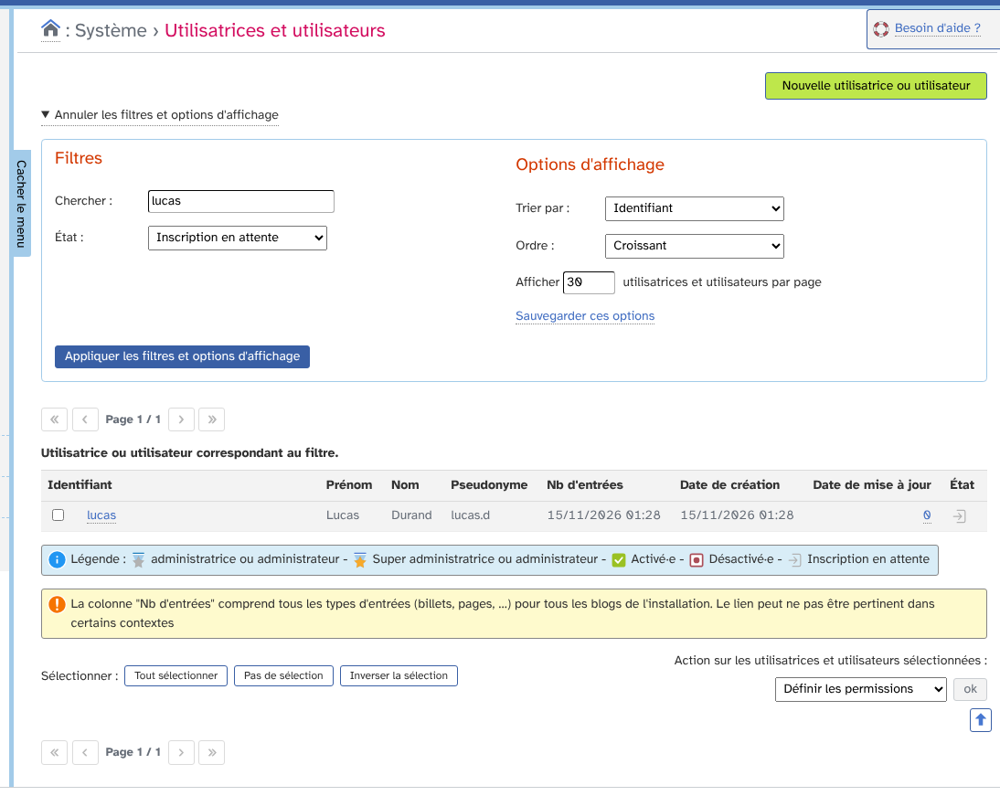

Cochez l'utilisateur, choisissez l'action **Activé·e** puis validez. L'utilisateur reçoit un mail d'activation avec le lien de la page de connexion. L'action **Inscription en attente** fait l'inverse : elle remet un compte en attente.

Un utilisateur ne peut se connecter que s'il a la permission « FrontendSession » sur le blog. Les comptes créés par l'inscription l'ont automatiquement.

## Connexion et changement de mot de passe

Une fois connecté, le visiteur voit son pseudonyme et un formulaire de changement de mot de passe.

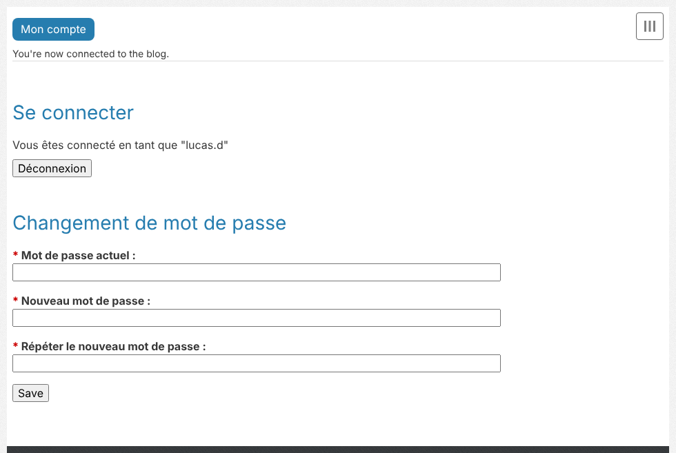

Il saisit son mot de passe actuel, puis le nouveau deux fois. Un message confirme le changement.

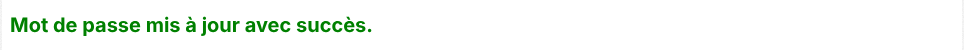

## Mot de passe oublié

Le visiteur saisit son identifiant et son email dans le formulaire « Mot de passe oublié ». Il reçoit un mail avec un lien.

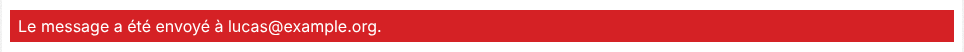

En cliquant sur ce lien, un nouveau mot de passe lui est envoyé par mail.

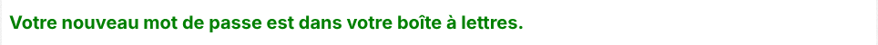

À sa première connexion avec ce mot de passe, il doit en choisir un nouveau.

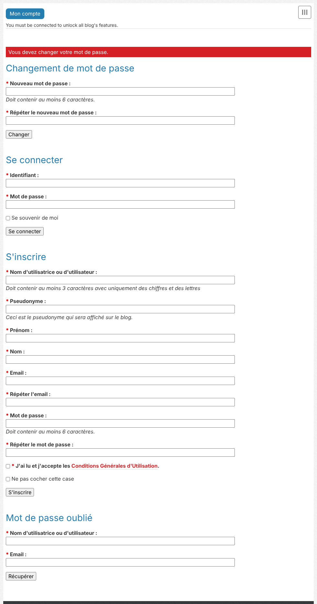

Les administrateurs du blog ne peuvent pas utiliser ce formulaire : ils doivent changer leur mot de passe depuis l'administration.

## Le widget

Dans **Widgets**, ajoutez le widget « Session publique » à la zone de votre choix. Il propose :

* le titre (« Mon compte » par défaut) ;
* le contenu : formulaire et menu, formulaire seul ou menu seul ;
* les options habituelles des widgets (pages concernées, classe CSS…).

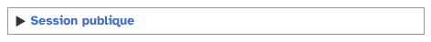

Sur le blog, il affiche un formulaire de connexion réduit pour un visiteur déconnecté.

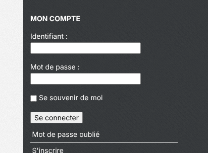

## Limiter les commentaires

Cochez **Limiter les nouveaux commentaires aux utilisateurs enregistrés** dans les réglages du blog. Les visiteurs non connectés ne voient alors plus le formulaire de commentaire. Tous les thèmes ne sont pas forcément compatibles avec cette option : vérifiez le résultat avec le vôtre.

## Bon à savoir

* Quand un visiteur demande un nouveau mot de passe, le message de succès est affiché comme une erreur (la présentation peut être rouge selon le thème) alors que le mail est bien envoyé.
* Quand les commentaires sont limités, aucun message n'explique aux visiteurs non connectés pourquoi le formulaire a disparu.
* Le message « You're now connected to the blog. » est affiché en anglais par défaut, même sur un blog en français : modifiez-le dans les réglages.
* Le mail d'activation et certains messages d'erreur contiennent des fautes de frappe ou un texte non traduit.
